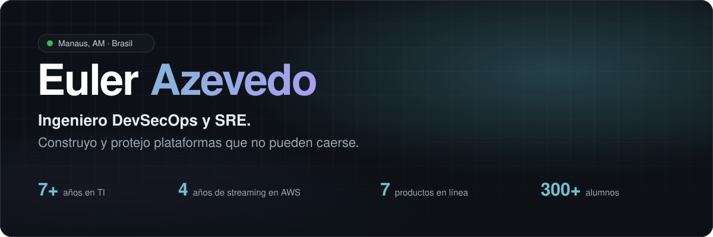
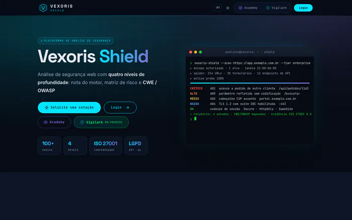
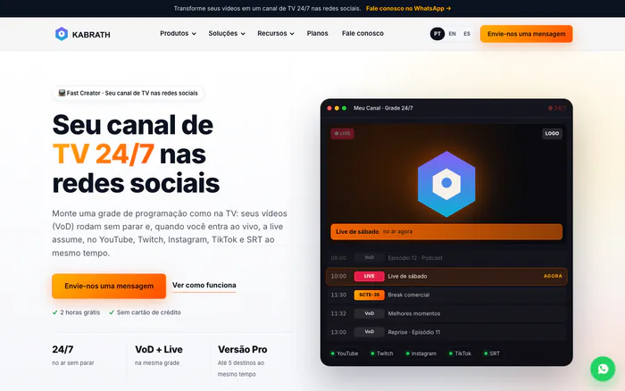
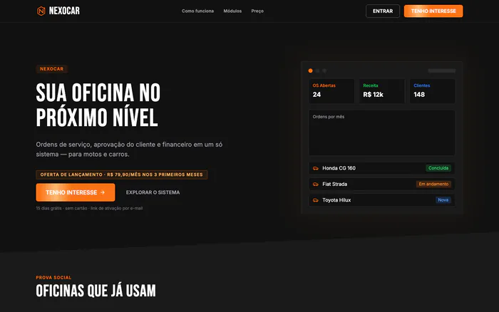
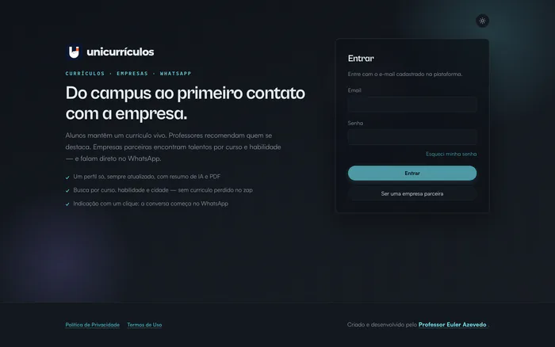
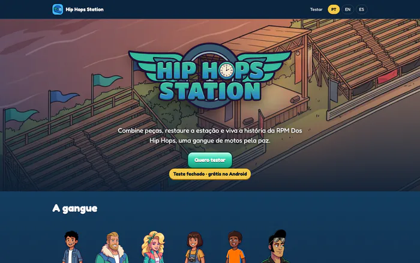
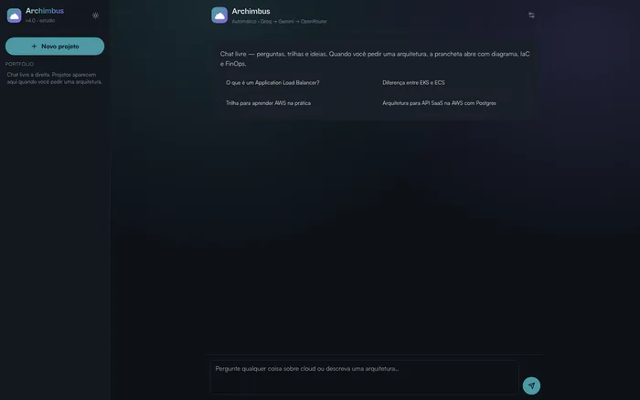
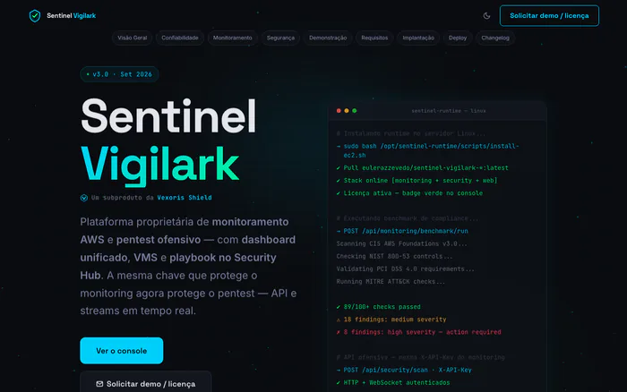
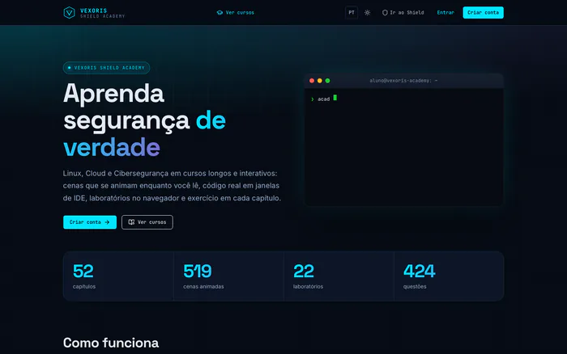
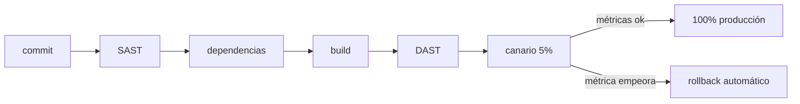

<a href="./README.md">English</a> · <a href="./README.pt-BR.md">Português</a> · <b>Español</b> · <a href="./README.fr.md">Français</a>

  
  
  
  
  

## Hola, soy Euler 👋

- 🔭 Actualmente trabajo en **[Kabrath](https://www.kabrath.com)** (cofundador y CTO), **[Vexoris Shield](https://vexorisshield.com)** y **[Nexocar](https://nexocar.app.br)**
- 💼 Analista Senior de Seguridad de la Información, con más de 7 años en TI y casi 5 en producción crítica en AWS
- 👨‍🏫 Profesor de Cloud Computing, Arquitectura de Software y Seguridad en UniNorte
- 🌱 Estoy aprendiendo Procesamiento de Lenguaje Natural (MBA en la UFG)
- 👯 Busco colaborar en proyectos de DevSecOps, SRE y streaming
- 💬 Pregúntame sobre AWS, disaster recovery, seguridad en pipelines y streaming en vivo (HLS, SRT, SCTE-35)
- 📫 Cómo contactarme: [euller.azevedo@gmail.com](mailto:euller.azevedo@gmail.com) o [LinkedIn](https://linkedin.com/in/eulerazevedo)
- ⚡ Dato curioso: un libro que escribí de niño se convirtió en un juego móvil, [Hip Hops Station](https://hip-hops-station.eulerazevedo.eng.br)

## Productos

<table>
  <tr>
    <td width="50%" valign="top">
      
      <h3><a href="https://vexorisshield.com">Vexoris Shield</a></h3>
       
      
<b><i>¿Cuánto de tu sitio está expuesto ahora mismo?</i></b>

      
Escáner de vulnerabilidades web. A partir de una URL ejecuta más de 100 checks (headers, TLS, cookies, pruebas activas, JWT, GraphQL), mapea los hallazgos a CWE y OWASP Top 10 y entrega un PDF listo para auditoría.

      <a href="https://vexorisshield.com">vexorisshield.com →</a>
    </td>
    <td width="50%" valign="top">
      
      <h3><a href="https://www.kabrath.com">Kabrath</a></h3>
       
      
<b><i>Un canal 24/7 no perdona 500 ms de pantalla negra.</i></b>

      
Lanza y opera canales FAST 24/7: playout, ingest en vivo con failover A/B, anuncios SCTE-35 y salida HLS. API-first, multicloud y on-premise.

      <a href="https://www.kabrath.com">kabrath.com →</a>
    </td>
  </tr>
  <tr>
    <td width="50%" valign="top">
      
      <h3><a href="https://nexocar.app.br">Nexocar</a></h3>
       
      
<b><i>El presupuesto del taller no puede perderse en WhatsApp.</i></b>

      
Gestión de talleres desde la orden de servicio hasta la aprobación del presupuesto en un clic, con finanzas y pagos en un solo lugar.

      <a href="https://nexocar.app.br">nexocar.app.br →</a>
    </td>
    <td width="50%" valign="top">
      
      <h3><a href="https://unicurriculos.eulerazevedo.eng.br">UniCurrículos</a></h3>
       
      
<b><i>El talento del campus se perdía en el camino hacia la empresa.</i></b>

      
Conecta alumnos, profesores y empresas aliadas. Perfil vivo con resumen de IA, recomendación de profesores y contacto directo por WhatsApp.

      <a href="https://unicurriculos.eulerazevedo.eng.br">unicurriculos.eulerazevedo.eng.br →</a>
    </td>
  </tr>
  <tr>
    <td width="50%" valign="top">
      
      <h3><a href="https://hip-hops-station.eulerazevedo.eng.br">Hip Hops Station</a></h3>
       
      
<b><i>Una historia escrita en la infancia se convirtió en un juego publicado.</i></b>

      
Juego de combinar piezas y restaurar lugares, basado en mi libro <i>RPM Dos Hip Hops</i>. 2 temporadas, 20 capítulos y 238 niveles, con guion, arte, música e ingeniería propios.

      <a href="https://hip-hops-station.eulerazevedo.eng.br/teste">Unirse a la prueba cerrada →</a>
    </td>
    <td width="50%" valign="top">
      
      <h3><a href="https://archimbus.eulerazevedo.eng.br">Archimbus</a></h3>
       
      
<b><i>De un prompt a una arquitectura cloud.</i></b>

      
Genera la arquitectura, el Terraform, un documento .docx y el diagrama a partir de una descripción simple. Funciona con Groq (Llama 3.3 70B) y Gemini.

      <a href="https://archimbus.eulerazevedo.eng.br">archimbus.eulerazevedo.eng.br →</a>
    </td>
  </tr>
  <tr>
    <td width="50%" valign="top">
      
      <h3><a href="https://sentinelvigilark.vexorisshield.com">Sentinel Vigilark</a></h3>
       
      
<b><i>Para redes que no pueden enviar datos hacia afuera.</i></b>

      
Versión on-prem de Vexoris Shield, con cerca de 115 checks CIS, NIST, ISO y PCI y 22 módulos de pentest con autorización.

      <a href="https://sentinelvigilark.vexorisshield.com">sentinelvigilark.vexorisshield.com →</a>
    </td>
    <td width="50%" valign="top">
      
      <h3><a href="https://academy.vexorisshield.com">Vexoris Academy</a></h3>
       
      
<b><i>La base antes de la especialización.</i></b>

      
Cursos gratuitos de Linux, Cloud y Ciberseguridad, con cerca de 26 clases en video.

      <a href="https://academy.vexorisshield.com">academy.vexorisshield.com →</a>
    </td>
  </tr>
</table>

<b>Más proyectos</b>

 

| Proyecto | Qué es |
| :-- | :-- |
| [**GradeOMR**](https://prova-omr.vercel.app) | Corrección de exámenes por lectura óptica con la cámara del celular, en uso en UniNorte |
| **Arcaro Care** | Investigación: wearable y app de alertas para personas neurodivergentes |
| **MediaStr** | Plataforma de VOD y en vivo de UniNorte con HLS adaptativo |
| [**Manual de Computação**](https://youtube.com/@manualdecomputacao) | Canal de YouTube sobre infraestructura, redes, cloud y carrera en TI |

## Cómo entrego

## Stack

<table>
  <tr>
    <td align="right"><b>Cloud & DevOps</b></td>
    <td>
      
      
      
      
      
      
    </td>
  </tr>
  <tr>
    <td align="right"><b>Seguridad</b></td>
    <td>
      
      
      
      
      
      
    </td>
  </tr>
  <tr>
    <td align="right"><b>Desarrollo</b></td>
    <td>
      
      
      
      
      
      
      
    </td>
  </tr>
  <tr>
    <td align="right"><b>Streaming</b></td>
    <td>
      
      
      
      
      
    </td>
  </tr>
  <tr>
    <td align="right"><b>IA & Juegos</b></td>
    <td>
      
      
      
      
    </td>
  </tr>
</table>

## Formación

- MBA en Natural Language Processing, UFG (en curso)
- MBA en Cloud Computing, XP Educação
- Ingeniería de Computación, UniNorte

  
  
  
  
  

 

  

  <b>Veinte minutos bastan.</b> 
  Abierto a posiciones senior, consultoría y alianzas.  
  

