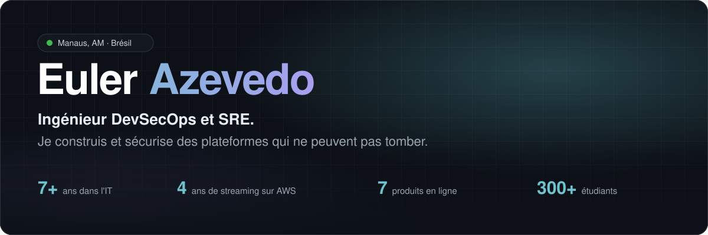
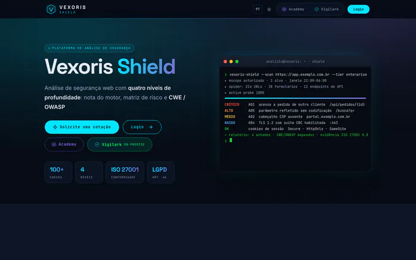
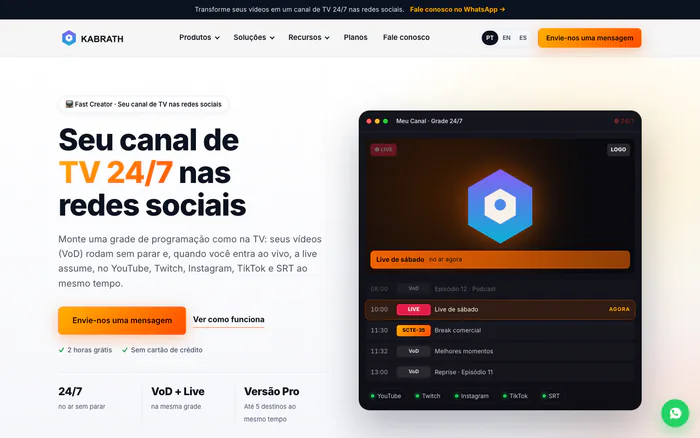
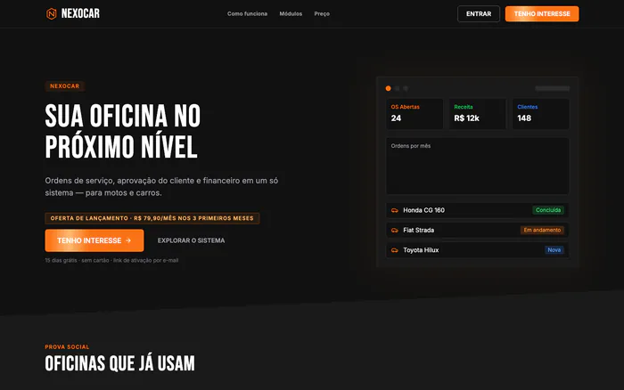
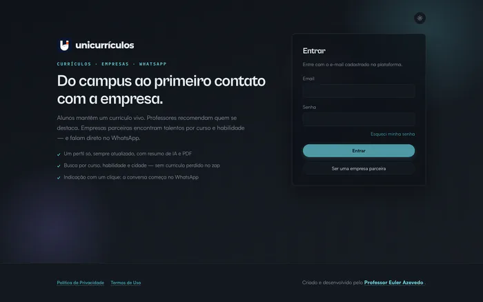
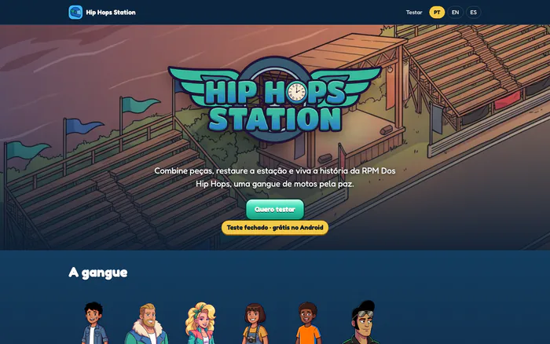
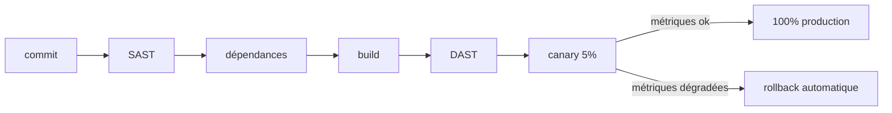

<a href="./README.md">English</a> · <a href="./README.pt-BR.md">Português</a> · <a href="./README.es.md">Español</a> · <b>Français</b>

  
  
  
  
  

## À propos

Ingénieur DevSecOps et SRE, avec plus de 7 ans dans l'IT et près de 5 en production critique sur AWS. Je suis passé par le support, les réseaux, l'infrastructure et le streaming en direct avant d'arriver à la sécurité.

Je construis des produits que je mets en ligne et exploite moi-même, du pipeline à l'incident.

**Aujourd'hui**

- Analyste Senior en Sécurité de l'Information chez **Positivo Tecnologia**
- Cofondateur et CTO de **[Kabrath](https://www.kabrath.com)**
- Fondateur de **[Vexoris Shield](https://vexorisshield.com)** et **[Nexocar](https://nexocar.app.br)**
- Professeur de Cloud Computing, Architecture Logicielle et Sécurité à **UniNorte**

## Produits

<table>
  <tr>
    <td width="50%" valign="top">
      
      <h3><a href="https://vexorisshield.com">Vexoris Shield</a></h3>
       
      
<b><i>Quelle part de votre site est exposée en ce moment ?</i></b>

      
Scanner de vulnérabilités web. À partir d'une URL, il exécute plus de 100 contrôles (headers, TLS, cookies, tests actifs, JWT, GraphQL), associe les résultats à CWE et OWASP Top 10 et livre un PDF prêt pour l'audit.

      <a href="https://vexorisshield.com">vexorisshield.com →</a>
    </td>
    <td width="50%" valign="top">
      
      <h3><a href="https://www.kabrath.com">Kabrath</a></h3>
       
      
<b><i>Une chaîne 24/7 ne pardonne pas 500 ms d'écran noir.</i></b>

      
Lance et exploite des chaînes FAST 24/7 : playout, ingest en direct avec failover A/B, publicités SCTE-35 et sortie HLS. API-first, multicloud et on-premise.

      <a href="https://www.kabrath.com">kabrath.com →</a>
    </td>
  </tr>
  <tr>
    <td width="50%" valign="top">
      
      <h3><a href="https://nexocar.app.br">Nexocar</a></h3>
       
      
<b><i>Le devis du garage ne doit pas se perdre dans WhatsApp.</i></b>

      
Gestion de garages, de l'ordre de réparation à l'approbation du devis en un clic, avec finances et paiements au même endroit.

      <a href="https://nexocar.app.br">nexocar.app.br →</a>
    </td>
    <td width="50%" valign="top">
      
      <h3><a href="https://unicurriculos.eulerazevedo.eng.br">UniCurrículos</a></h3>
       
      
<b><i>Les talents du campus se perdaient en chemin vers l'entreprise.</i></b>

      
Relie étudiants, professeurs et entreprises partenaires. Profil vivant avec résumé par IA, recommandations des professeurs et contact direct sur WhatsApp.

      <a href="https://unicurriculos.eulerazevedo.eng.br">unicurriculos.eulerazevedo.eng.br →</a>
    </td>
  </tr>
  <tr>
    <td colspan="2" valign="top">
      
      <h3><a href="https://hip-hops-station.eulerazevedo.eng.br">Hip Hops Station</a></h3>
       
      
<b><i>Une histoire écrite dans l'enfance est devenue un jeu publié.</i></b>

      
Jeu d'association et de restauration basé sur mon livre <i>RPM Dos Hip Hops</i>. 2 saisons, 20 chapitres et 238 niveaux, avec scénario, art, musique et ingénierie maison.

      <a href="https://hip-hops-station.eulerazevedo.eng.br/teste">Rejoindre le test fermé →</a>
    </td>
  </tr>
</table>

<b>Autres projets</b>

 

| Projet | Ce que c'est |
| :-- | :-- |
| [**Archimbus**](https://archimbus.eulerazevedo.eng.br) | IA qui transforme un prompt en architecture cloud, Terraform, .docx et diagramme |
| [**GradeOMR**](https://prova-omr.vercel.app) | Correction d'examens par lecture optique avec la caméra du téléphone, utilisée à UniNorte |
| [**Sentinel Vigilark**](https://sentinelvigilark.vexorisshield.com) | Version on-prem de Vexoris Shield avec contrôles CIS, NIST, ISO et PCI |
| [**Vexoris Academy**](https://academy.vexorisshield.com) | Cours gratuits de Linux, Cloud et Cybersécurité |
| **Arcaro Care** | Recherche : wearable et app d'alertes pour personnes neurodivergentes |
| **MediaStr** | Plateforme VOD et direct d'UniNorte avec HLS adaptatif |
| [**Manual de Computação**](https://youtube.com/@manualdecomputacao) | Chaîne YouTube sur l'infrastructure, les réseaux, le cloud et les carrières IT |

## Comment je livre

## Stack

<table>
  <tr>
    <td align="right"><b>Cloud & DevOps</b></td>
    <td>
      
      
      
      
      
      
    </td>
  </tr>
  <tr>
    <td align="right"><b>Sécurité</b></td>
    <td>
      
      
      
      
      
      
    </td>
  </tr>
  <tr>
    <td align="right"><b>Développement</b></td>
    <td>
      
      
      
      
      
      
      
    </td>
  </tr>
  <tr>
    <td align="right"><b>Streaming</b></td>
    <td>
      
      
      
      
      
    </td>
  </tr>
  <tr>
    <td align="right"><b>IA & Jeux</b></td>
    <td>
      
      
      
      
    </td>
  </tr>
</table>

## Parcours

<table>
  <tr>
    <td><code>2026 · auj.</code></td>
    <td><b>Analyste Senior en Sécurité de l'Information</b> Positivo Tecnologia</td>
  </tr>
  <tr>
    <td><code>2022 · 2026</code></td>
    <td><b>De Junior à Consultant Cloud Architecture, streaming sur AWS</b> Watch Brasil</td>
  </tr>
  <tr>
    <td><code>2020 · 2022</code></td>
    <td><b>Analyste Infrastructure Réseau</b> Grupo Queiroz</td>
  </tr>
  <tr>
    <td><code>2019 · 2020</code></td>
    <td><b>Stagiaire IT</b> Ministère Public et Secrétariat à la Sécurité de l'Amazonas</td>
  </tr>
</table>

## Formation

- MBA en Natural Language Processing, UFG (en cours)
- MBA en Cloud Computing, XP Educação
- Ingénieur en Informatique, UniNorte

  
  
  
  
  

 

  

  <b>Vingt minutes suffisent.</b> 
  Ouvert aux postes seniors, au conseil et aux partenariats.  
  

