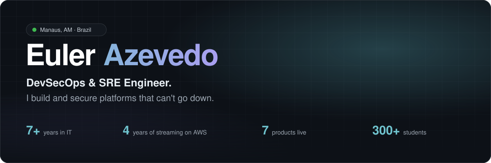
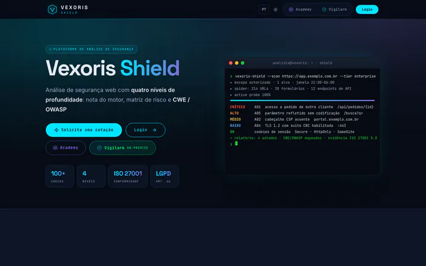
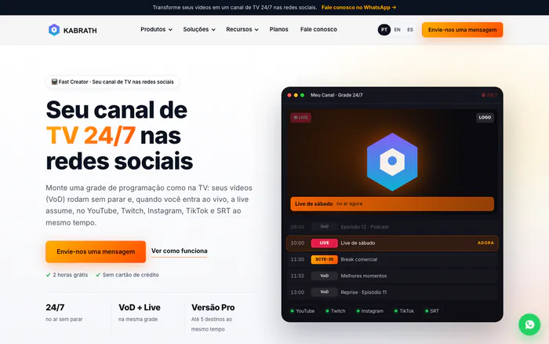
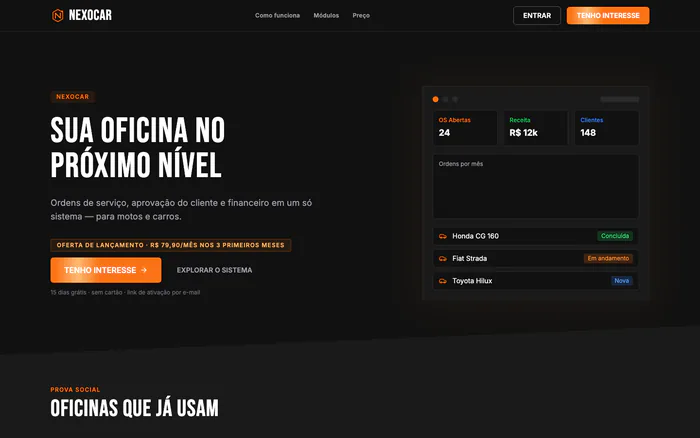
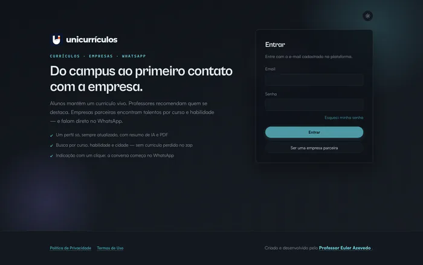
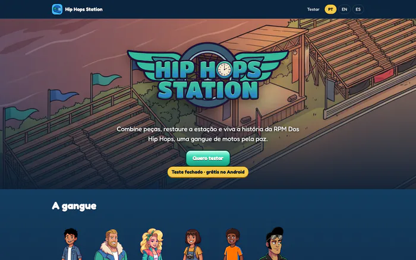
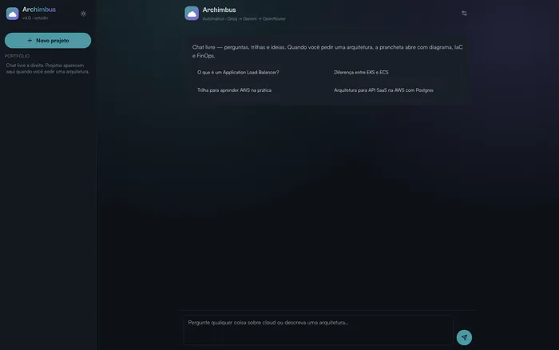
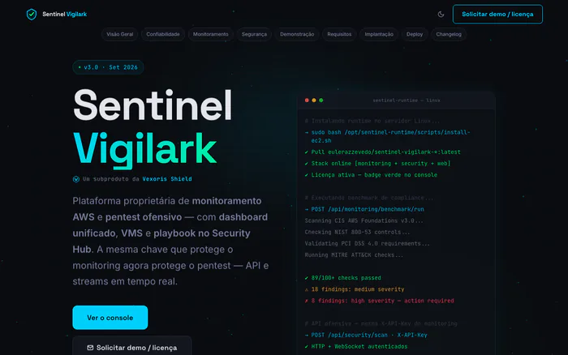
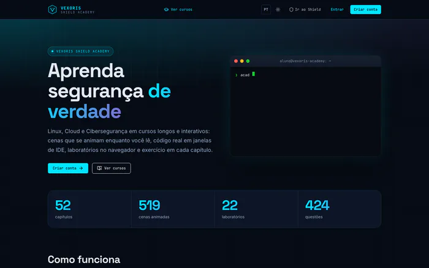
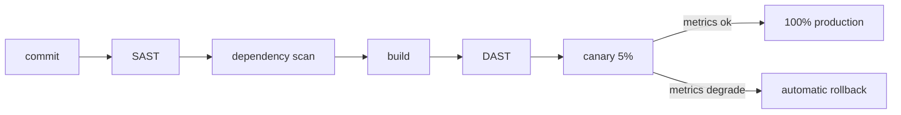

<b>English</b> · <a href="./README.pt-BR.md">Português</a> · <a href="./README.es.md">Español</a> · <a href="./README.fr.md">Français</a>

  
  
  
  
  

## About

DevSecOps and SRE engineer with 7+ years in IT and almost 5 running mission-critical production on AWS. I came up through support, networking, infrastructure and live streaming before moving into security.

I build products that I ship and run myself, from the pipeline to the incident.

**Now**

- Senior Information Security Analyst
- Co-founder & CTO at **[Kabrath](https://www.kabrath.com)**
- Founder of **[Vexoris Shield](https://vexorisshield.com)** and **[Nexocar](https://nexocar.app.br)**
- Professor of Cloud Computing, Software Architecture and Security at **UniNorte**

## Products

<table>
  <tr>
    <td width="50%" valign="top">
      
      <h3><a href="https://vexorisshield.com">Vexoris Shield</a></h3>
       
      
<b><i>How much of your site is exposed right now?</i></b>

      
Web vulnerability scanner. From a single URL it runs 100+ checks (headers, TLS, cookies, active probes, JWT, GraphQL), maps findings to CWE and OWASP Top 10 and delivers an audit-ready PDF.

      <a href="https://vexorisshield.com">vexorisshield.com →</a>
    </td>
    <td width="50%" valign="top">
      
      <h3><a href="https://www.kabrath.com">Kabrath</a></h3>
       
      
<b><i>A 24/7 channel won't forgive 500 ms of black screen.</i></b>

      
Launch and run 24/7 FAST channels: playout, live ingest with A/B failover, SCTE-35 ad insertion and HLS output. API-first, multicloud and on-prem.

      <a href="https://www.kabrath.com">kabrath.com →</a>
    </td>
  </tr>
  <tr>
    <td width="50%" valign="top">
      
      <h3><a href="https://nexocar.app.br">Nexocar</a></h3>
       
      
<b><i>A shop's quote shouldn't get lost in WhatsApp.</i></b>

      
Repair shop management from work order to one-click quote approval, with finance and PIX payments in one place.

      <a href="https://nexocar.app.br">nexocar.app.br →</a>
    </td>
    <td width="50%" valign="top">
      
      <h3><a href="https://unicurriculos.eulerazevedo.eng.br">UniCurrículos</a></h3>
       
      
<b><i>Campus talent got lost on the way to the company.</i></b>

      
Connects students, professors and partner companies. Living profiles with AI summaries, professor endorsements and direct contact on WhatsApp.

      <a href="https://unicurriculos.eulerazevedo.eng.br">unicurriculos.eulerazevedo.eng.br →</a>
    </td>
  </tr>
  <tr>
    <td width="50%" valign="top">
      
      <h3><a href="https://hip-hops-station.eulerazevedo.eng.br">Hip Hops Station</a></h3>
       
      
<b><i>A story written in childhood became a published game.</i></b>

      
Match-and-restore puzzle game based on my book <i>RPM Dos Hip Hops</i>. 2 seasons, 20 chapters, 238 levels, with my own story, art, soundtrack and engineering.

      <a href="https://hip-hops-station.eulerazevedo.eng.br/teste">Join the closed test →</a>
    </td>
    <td width="50%" valign="top">
      
      <h3><a href="https://archimbus.eulerazevedo.eng.br">Archimbus</a></h3>
       
      
<b><i>From a prompt to a cloud architecture.</i></b>

      
Generates the architecture, Terraform, a .docx document and the diagram from a plain description. Runs on Groq (Llama 3.3 70B) and Gemini.

      <a href="https://archimbus.eulerazevedo.eng.br">archimbus.eulerazevedo.eng.br →</a>
    </td>
  </tr>
  <tr>
    <td width="50%" valign="top">
      
      <h3><a href="https://sentinelvigilark.vexorisshield.com">Sentinel Vigilark</a></h3>
       
      
<b><i>For networks that can't send data out.</i></b>

      
On-prem edition of Vexoris Shield with around 115 CIS, NIST, ISO and PCI checks and 22 authorized pentest modules.

      <a href="https://sentinelvigilark.vexorisshield.com">sentinelvigilark.vexorisshield.com →</a>
    </td>
    <td width="50%" valign="top">
      
      <h3><a href="https://academy.vexorisshield.com">Vexoris Academy</a></h3>
       
      
<b><i>The foundation before the specialization.</i></b>

      
Free courses on Linux, Cloud and Cybersecurity, with around 26 video lessons.

      <a href="https://academy.vexorisshield.com">academy.vexorisshield.com →</a>
    </td>
  </tr>
</table>

<b>More projects</b>

 

| Project | What it is |
| :-- | :-- |
| [**GradeOMR**](https://prova-omr.vercel.app) | Exam grading by optical mark recognition with a phone camera, used at UniNorte |
| **Arcaro Care** | Research project: wearable and alert app for neurodivergent people |
| **MediaStr** | UniNorte's VOD and live platform with adaptive HLS |
| [**Manual de Computação**](https://youtube.com/@manualdecomputacao) | YouTube channel on infrastructure, networking, cloud and IT careers |

## How I ship

## Stack

<table>
  <tr>
    <td align="right"><b>Cloud & DevOps</b></td>
    <td>
      
      
      
      
      
      
    </td>
  </tr>
  <tr>
    <td align="right"><b>Security</b></td>
    <td>
      
      
      
      
      
      
    </td>
  </tr>
  <tr>
    <td align="right"><b>Development</b></td>
    <td>
      
      
      
      
      
      
      
    </td>
  </tr>
  <tr>
    <td align="right"><b>Streaming</b></td>
    <td>
      
      
      
      
      
    </td>
  </tr>
  <tr>
    <td align="right"><b>AI & Games</b></td>
    <td>
      
      
      
      
    </td>
  </tr>
</table>

## Education

- MBA in Natural Language Processing, UFG (in progress)
- MBA in Cloud Computing, XP Educação
- B.Sc. in Computer Engineering, UniNorte

  
  
  
  
  

 

  

  <b>Twenty minutes is enough.</b> 
  Open to senior roles, consulting and partnerships.  
  

