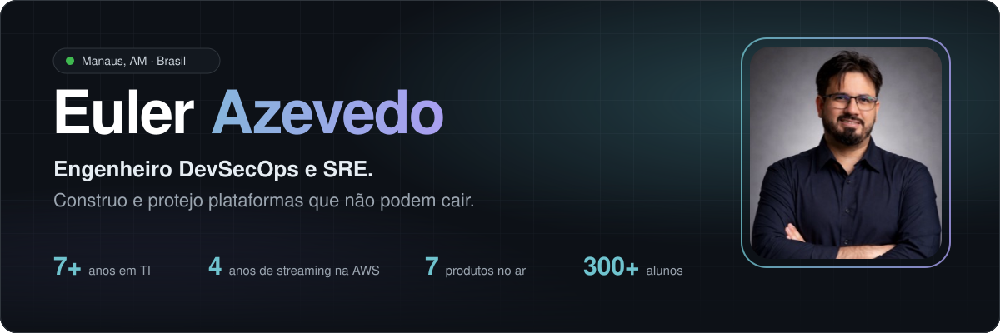
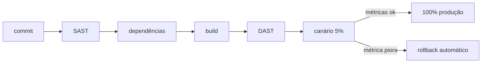

  

  
  
  
  
  

  🌐 <a href="https://www.eulerazevedo.eng.br">Português</a> · <a href="https://www.eulerazevedo.eng.br/en">English</a> · <a href="https://www.eulerazevedo.eng.br/es">Español</a> · <a href="https://www.eulerazevedo.eng.br/fr">Français</a>

 

## 👋 Sobre mim

Sou SRE, DevOps e SecOps, com mais de 7 anos em TI e quase 5 em produção crítica na AWS. Passei por suporte, redes, infraestrutura e streaming ao vivo antes de chegar à segurança.

Acredito que **quem projeta bem é quem já operou**. Por isso construo produtos que eu mesmo coloco no ar e mantenho, do pipeline ao incidente.

<table>
  <tr>
    <td>🛡️</td>
    <td><b>Analista de Segurança da Informação, Sênior</b> na Positivo Tecnologia</td>
  </tr>
  <tr>
    <td>📡</td>
    <td><b>Co-fundador e CTO</b> da <a href="https://www.kabrath.com">Kabrath</a></td>
  </tr>
  <tr>
    <td>🚀</td>
    <td><b>CEO e Platform Architect</b> do <a href="https://vexorisshield.com">Vexoris Shield</a> e do <a href="https://nexocar.app.br">Nexocar</a></td>
  </tr>
  <tr>
    <td>🎓</td>
    <td><b>Professor</b> na UniNorte em Cloud Computing, Arquitetura de Software e Segurança da Informação</td>
  </tr>
</table>

 

## 🧩 Produtos que construí e opero

> Cada um resolve um problema concreto e está no ar, em produção, em beta ou em piloto.

<table>
  <tr>
    <td width="50%" valign="top">
      
      <h3>🛡️ Vexoris Shield</h3>
      
      
      
<i>Quanto do seu site está exposto agora?</i>

      
Scanner online de vulnerabilidades web. Mais de 100 checks em 4 níveis, achados mapeados em CWE e OWASP Top 10 e PDF pronto para auditoria. Inclui o Sentinel Vigilark on-prem e a Vexoris Academy.

      
<a href="https://vexorisshield.com"><b>vexorisshield.com →</b></a>

    </td>
    <td width="50%" valign="top">
      
      <h3>📡 Kabrath</h3>
      
      
      
<i>Um canal de TV 24/7 não perdoa 500 ms de tela preta.</i>

      
Plataforma para lançar e operar canais FAST 24/7: playout, ingest ao vivo com failover A/B, anúncios SCTE-35 e saída HLS. API-first, multicloud e on-premise.

      
<a href="https://www.kabrath.com"><b>kabrath.com →</b></a>

    </td>
  </tr>
  <tr>
    <td width="50%" valign="top">
      
      <h3>🔧 Nexocar</h3>
      
      
      
<i>O orçamento da oficina não pode se perder no WhatsApp.</i>

      
Gestão de oficinas de carro e moto, da ordem de serviço à aprovação do orçamento em um clique, com financeiro e PIX no mesmo lugar.

      
<a href="https://nexocar.app.br"><b>nexocar.app.br →</b></a>

    </td>
    <td width="50%" valign="top">
      
      <h3>🎓 UniCurrículos</h3>
      
      
      
<i>O talento do campus se perdia no caminho até a empresa.</i>

      
Liga alunos, professores e empresas parceiras. Perfil vivo com resumo de IA, indicação de professores e contato direto pelo WhatsApp.

      
<a href="https://unicurriculos.eulerazevedo.eng.br"><b>unicurriculos.eulerazevedo.eng.br →</b></a>

    </td>
  </tr>
  <tr>
    <td colspan="2" valign="top">
      
      <h3>🎮 Hip Hops Station</h3>
      
      
      
<i>Uma história escrita na infância virou um jogo publicado.</i>

      
Jogo de combinar peças e restaurar lugares, baseado no livro <i>RPM Dos Hip Hops</i>, de minha autoria. Duas temporadas, 20 capítulos e 238 fases, com roteiro, arte, trilha e engenharia próprios.

      
<a href="https://hip-hops-station.eulerazevedo.eng.br/teste"><b>Entrar no teste fechado →</b></a>

    </td>
  </tr>
</table>

<b>➕ Mais projetos no ar</b>

 

| Projeto | O que é |
| :-- | :-- |
| [**Archimbus**](https://archimbus.eulerazevedo.eng.br) | IA que gera arquitetura cloud, Terraform, .docx e diagrama a partir de um prompt |
| [**GradeOMR**](https://prova-omr.vercel.app) | Correção de provas por leitura óptica com a câmera do celular, em uso na UniNorte |
| [**Sentinel Vigilark**](https://sentinelvigilark.vexorisshield.com) | Versão on-prem do Vexoris Shield, com checks CIS, NIST, ISO e PCI |
| [**Vexoris Academy**](https://academy.vexorisshield.com) | Cursos gratuitos de Linux, Cloud e Cibersegurança |
| **Arcaro Care** | Iniciação científica: wearable e app de alertas para pessoas neurodivergentes |
| **MediaStr** | VOD e transmissões ao vivo da UniNorte com HLS adaptativo |
| [**Manual de Computação**](https://youtube.com/@manualdecomputacao) | Canal no YouTube sobre infraestrutura, redes, cloud e carreira |

 

## ⚙️ Como eu opero

Segurança desde o pipeline e alta disponibilidade na arquitetura: cada commit passa por gates de segurança antes de chegar à produção, e o ingest roda em caminhos A/B que trocam sem o espectador perceber.

 

## 🛠️ Stack

<table>
  <tr>
    <td align="right"><b>Cloud & DevOps</b></td>
    <td>
      
      
      
      
      
      
    </td>
  </tr>
  <tr>
    <td align="right"><b>Segurança</b></td>
    <td>
      
      
      
      
      
      
    </td>
  </tr>
  <tr>
    <td align="right"><b>Desenvolvimento</b></td>
    <td>
      
      
      
      
      
      
      
    </td>
  </tr>
  <tr>
    <td align="right"><b>Streaming</b></td>
    <td>
      
      
      
      
      
    </td>
  </tr>
  <tr>
    <td align="right"><b>IA & Jogos</b></td>
    <td>
      
      
      
      
    </td>
  </tr>
</table>

 

## 🧭 Trajetória

<b>Ver experiência completa</b>

 

| Período | Cargo | Onde |
| :-- | :-- | :-- |
| mai/2026 · hoje | Analista de Segurança da Informação, Sênior | Positivo Tecnologia |
| abr/2026 · hoje | Co-fundador e CTO | Kabrath |
| abr/2026 · hoje | CEO & Platform Architect | Nexocar |
| jan/2026 · hoje | CEO & Platform Architect | Vexoris Shield |
| jul/2024 · hoje | Professor de Ensino Superior | UniNorte |
| fev/2022 · abr/2026 | Jr. → Pleno → Consultor de Cloud Architecture | Watch Brasil |
| out/2020 · fev/2022 | Analista de Infraestrutura de Redes | Grupo Queiroz |
| set/2019 · out/2020 | Estagiário de TI | MPAM |
| mar/2019 · set/2019 | Estagiário de TI | SSP-AM |

 

## 🏅 Formação e certificações

- **MBA em Natural Language Processing**, UFG (em andamento)
- **MBA em Cloud Computing**, XP Educação
- **Engenharia de Computação**, UniNorte

  
  
  
  
  

Todas as credenciais verificáveis estão no <a href="https://www.eulerazevedo.eng.br/#formacao">site</a>.

 

## 📊 No GitHub

  

 

  <b>Vinte minutos bastam.</b> 
  Para falar de uma posição, de um projeto ou de um dos produtos.  
  

📍 Manaus, AM · Disponível para consultoria, parcerias e novos desafios

