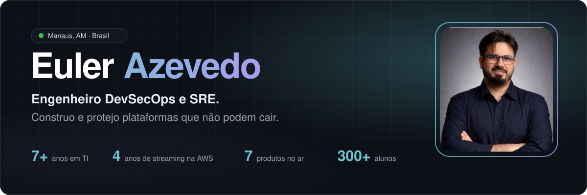
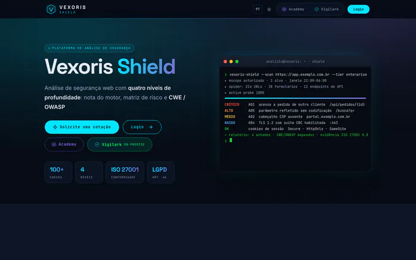
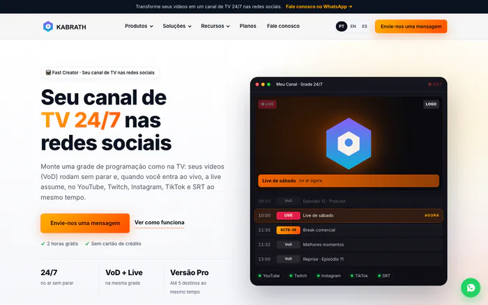
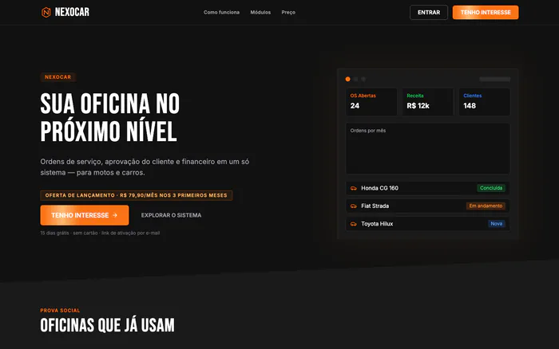
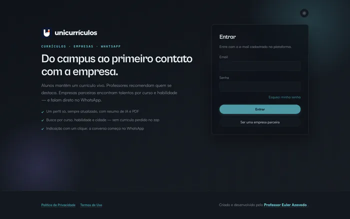
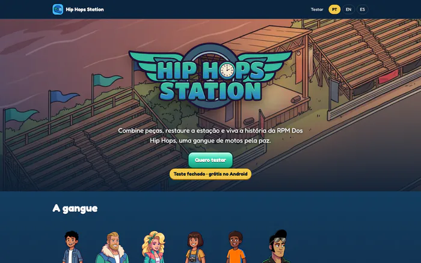
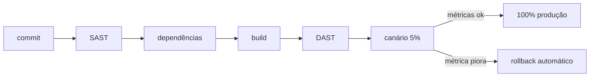

<a href="./README.md">English</a> · <b>Português</b> · <a href="./README.es.md">Español</a> · <a href="./README.fr.md">Français</a>

  
  
  
  
  

## Sobre

Engenheiro DevSecOps e SRE, com mais de 7 anos em TI e quase 5 em produção crítica na AWS. Passei por suporte, redes, infraestrutura e streaming ao vivo antes de chegar à segurança.

Construo produtos que eu mesmo coloco no ar e mantenho, do pipeline ao incidente.

**Hoje**

- Analista de Segurança da Informação Sênior na **Positivo Tecnologia**
- Co-fundador e CTO da **[Kabrath](https://www.kabrath.com)**
- Fundador do **[Vexoris Shield](https://vexorisshield.com)** e do **[Nexocar](https://nexocar.app.br)**
- Professor de Cloud Computing, Arquitetura de Software e Segurança na **UniNorte**

## Produtos

<table>
  <tr>
    <td width="50%" valign="top">
      
      <h3><a href="https://vexorisshield.com">Vexoris Shield</a></h3>
       
      
<b><i>Quanto do seu site está exposto agora?</i></b>

      
Scanner de vulnerabilidades web. A partir de uma URL, roda mais de 100 checks (headers, TLS, cookies, testes ativos, JWT, GraphQL), mapeia os achados em CWE e OWASP Top 10 e entrega um PDF pronto para auditoria.

      <a href="https://vexorisshield.com">vexorisshield.com →</a>
    </td>
    <td width="50%" valign="top">
      
      <h3><a href="https://www.kabrath.com">Kabrath</a></h3>
       
      
<b><i>Um canal 24/7 não perdoa 500 ms de tela preta.</i></b>

      
Lança e opera canais FAST 24/7: playout, ingest ao vivo com failover A/B, anúncios SCTE-35 e saída HLS. API-first, multicloud e on-premise.

      <a href="https://www.kabrath.com">kabrath.com →</a>
    </td>
  </tr>
  <tr>
    <td width="50%" valign="top">
      
      <h3><a href="https://nexocar.app.br">Nexocar</a></h3>
       
      
<b><i>O orçamento da oficina não pode se perder no WhatsApp.</i></b>

      
Gestão de oficinas da ordem de serviço à aprovação do orçamento em um clique, com financeiro e PIX no mesmo lugar.

      <a href="https://nexocar.app.br">nexocar.app.br →</a>
    </td>
    <td width="50%" valign="top">
      
      <h3><a href="https://unicurriculos.eulerazevedo.eng.br">UniCurrículos</a></h3>
       
      
<b><i>O talento do campus se perdia no caminho até a empresa.</i></b>

      
Liga alunos, professores e empresas parceiras. Perfil vivo com resumo de IA, indicação de professores e contato direto pelo WhatsApp.

      <a href="https://unicurriculos.eulerazevedo.eng.br">unicurriculos.eulerazevedo.eng.br →</a>
    </td>
  </tr>
  <tr>
    <td colspan="2" valign="top">
      
      <h3><a href="https://hip-hops-station.eulerazevedo.eng.br">Hip Hops Station</a></h3>
       
      
<b><i>Uma história escrita na infância virou um jogo publicado.</i></b>

      
Jogo de combinar peças e restaurar lugares, baseado no meu livro <i>RPM Dos Hip Hops</i>. 2 temporadas, 20 capítulos e 238 fases, com roteiro, arte, trilha e engenharia próprios.

      <a href="https://hip-hops-station.eulerazevedo.eng.br/teste">Entrar no teste fechado →</a>
    </td>
  </tr>
</table>

<b>Mais projetos</b>

 

| Projeto | O que é |
| :-- | :-- |
| [**Archimbus**](https://archimbus.eulerazevedo.eng.br) | IA que transforma um prompt em arquitetura cloud, Terraform, .docx e diagrama |
| [**GradeOMR**](https://prova-omr.vercel.app) | Correção de provas por leitura óptica com a câmera do celular, em uso na UniNorte |
| [**Sentinel Vigilark**](https://sentinelvigilark.vexorisshield.com) | Versão on-prem do Vexoris Shield com checks CIS, NIST, ISO e PCI |
| [**Vexoris Academy**](https://academy.vexorisshield.com) | Cursos gratuitos de Linux, Cloud e Cibersegurança |
| **Arcaro Care** | Pesquisa: wearable e app de alertas para pessoas neurodivergentes |
| **MediaStr** | Plataforma de VOD e ao vivo da UniNorte com HLS adaptativo |
| [**Manual de Computação**](https://youtube.com/@manualdecomputacao) | Canal no YouTube sobre infraestrutura, redes, cloud e carreira em TI |

## Como eu entrego

## Stack

<table>
  <tr>
    <td align="right"><b>Cloud & DevOps</b></td>
    <td>
      
      
      
      
      
      
    </td>
  </tr>
  <tr>
    <td align="right"><b>Segurança</b></td>
    <td>
      
      
      
      
      
      
    </td>
  </tr>
  <tr>
    <td align="right"><b>Desenvolvimento</b></td>
    <td>
      
      
      
      
      
      
      
    </td>
  </tr>
  <tr>
    <td align="right"><b>Streaming</b></td>
    <td>
      
      
      
      
      
    </td>
  </tr>
  <tr>
    <td align="right"><b>IA & Jogos</b></td>
    <td>
      
      
      
      
    </td>
  </tr>
</table>

## Trajetória

<table>
  <tr>
    <td><code>2026 · hoje</code></td>
    <td><b>Analista de Segurança da Informação Sênior</b> Positivo Tecnologia</td>
  </tr>
  <tr>
    <td><code>2022 · 2026</code></td>
    <td><b>De Júnior a Consultor de Cloud Architecture, streaming na AWS</b> Watch Brasil</td>
  </tr>
  <tr>
    <td><code>2020 · 2022</code></td>
    <td><b>Analista de Infraestrutura de Redes</b> Grupo Queiroz</td>
  </tr>
  <tr>
    <td><code>2019 · 2020</code></td>
    <td><b>Estagiário de TI</b> MPAM e SSP-AM</td>
  </tr>
</table>

## Formação

- MBA em Natural Language Processing, UFG (em andamento)
- MBA em Cloud Computing, XP Educação
- Engenharia de Computação, UniNorte

  
  
  
  
  

 

  

  <b>Vinte minutos bastam.</b> 
  Aberto a posições sênior, consultoria e parcerias.  
  

